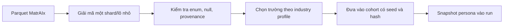
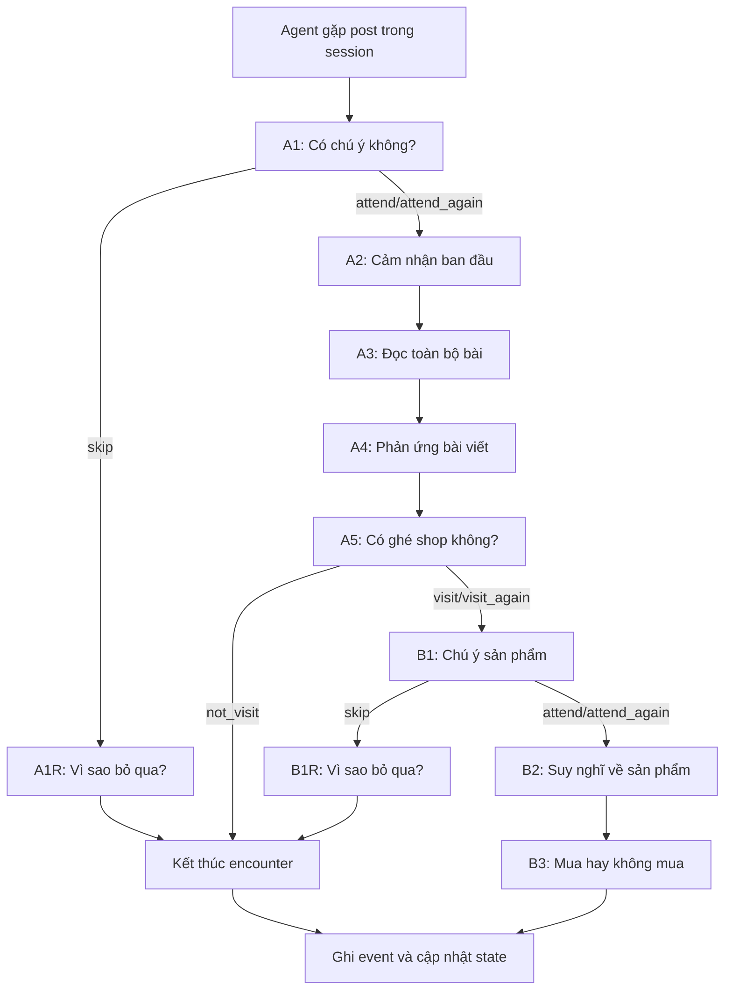
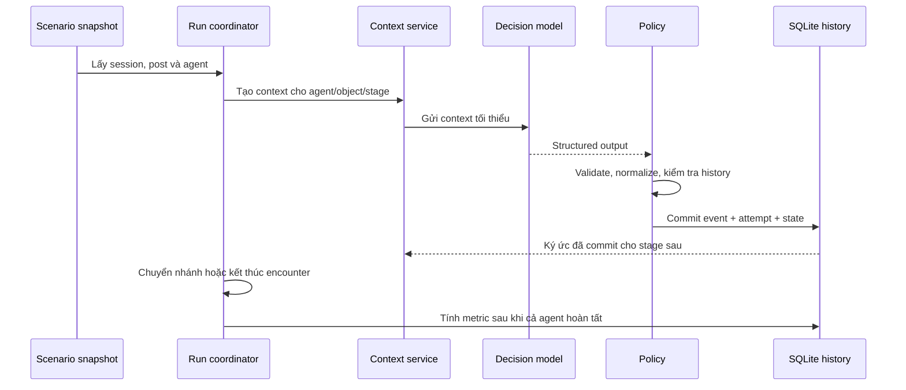

# ecoSim: dữ liệu và mô hình ra quyết định

## 1. Ý tưởng cốt lõi

ecoSim là một môi trường thử nghiệm có kiểm soát. Hệ thống đưa một persona
vào một tình huống, cho persona nhìn thấy một thông tin, rồi mô phỏng chuỗi
quyết định tiếp theo.

```text
persona + quan hệ ban đầu + lịch sử đã ghi nhận + thông tin hiện tại
        ↓
decision model
        ↓
chú ý → đọc → cảm nhận → phản ứng → ghé shop → mua/không mua
        ↓
event, state, history, metrics
```

Nguyên tắc sản phẩm là **decision model is everything**. Persona không tự nó
tạo ra hành vi. Bài viết, sản phẩm, lịch sử và quan hệ cũng không tự quyết
định thay agent. Chúng chỉ là đầu vào có giới hạn cho mô hình quyết định tại
một bước cụ thể. Mọi hành động phải đi qua decision model, được kiểm tra bởi
policy, rồi mới được ghi thành lịch sử.

## 2. ecoSim hiện có gì

MVP hiện tại là mô phỏng ngành cà phê, chạy theo `campaign → scenario → run`:

- `campaign`: nội dung chiến dịch, thương hiệu, shop, bài viết và sản phẩm;
- `scenario`: chọn cohort, số agent, số phiên, lịch bài, quan hệ ban đầu và
  policy;
- `run`: bản chụp bất biến của scenario để chạy lại mà không bị thay đổi dữ
  liệu đầu vào.

Backend là modular monolith Python, FastAPI, SQLite và một coordinator. Dữ
liệu persona được nạp offline; khi run diễn ra, engine không đọc lại Parquet.
JEV là gateway chính cho decision model; LLM structured-output là đường dự
phòng. Kết quả model không được ghi thẳng thành hành vi: `policy.py` kiểm tra
schema, enum, xác suất, lịch sử và điều kiện của stage trước khi commit.

## 3. Các lớp dữ liệu

### 3.1. Dữ liệu nguồn persona

Nguồn là MatrAIx trong `data/matraix/persona_1m/`:

- các shard Parquet chứa persona dạng mã 4-bit đóng gói;
- `persona_codes.schema.json` định nghĩa 1.290 trường, enum và category;
- `manifest.json`, metadata và hash xác định phiên bản dữ liệu;
- `projectdut_persona.schema.json` là schema rút gọn dành cho ecoSim.

Parquet là dữ liệu nguồn, không phải dữ liệu runtime. Quy trình đúng là:



Trường thiếu vẫn là thiếu. `observed` nghĩa là trường có trong nguồn, không
đồng nghĩa người thật đã xác nhận. `derived` là giá trị suy ra bằng rule đã
ghi lại. `imputed_prior` là giá trị hoàn thiện theo prior có seed. Ba trạng
thái này phải được giữ trong provenance để không nhầm giá trị ước lượng với
dữ liệu quan sát.

### 3.2. Schema persona rút gọn

Schema rút gọn hiện định nghĩa tối đa 70 trường được phép dùng trong context,
nhưng cohort cafe hiện tại có 100 persona và mỗi persona chứa 22 trường đã
project. Các trường hiện có gồm nhóm hành vi mua sắm, cà phê, nhận thức,
quyết định và phân nhóm:

```text
lstyle_shopping_style, economic_motivation,
topic_coffee, lstyle_coffee_ritual, lstyle_caffeine, topic_tea,
att_advertising, cog_attention_span, cog_detail_orientation,
cog_skepticism, decision_style, need_for_cognition,
pref_novelty_vs_familiarity, pref_quality_vs_quantity,
schwartz_value_hedonism, trait_curiosity, topic_baking,
age_bracket, life_stage, region, urbanicity, socioeconomic_band
```

Không phải trường nào cũng được đưa vào mọi prompt. `industry profile` chia
chúng thành:

- **đặc điểm chung**: cách chú ý, suy nghĩ, lựa chọn và phản ứng;
- **đặc điểm ngành**: quan tâm cà phê, thói quen dùng cà phê, caffeine;
- **trường phân nhóm**: tuổi, khu vực, đô thị/nông thôn, giai đoạn cuộc sống,
  mức kinh tế;
- **trường theo stage**: mapping chỉ rõ stage nào được phép nhìn thấy field
  nào.

Đây là bộ gợi ý cho decision model, không phải luật nhân quả. Ví dụ
`cog_skepticism = High` không có nghĩa agent chắc chắn sẽ từ chối mua; nó chỉ
cho model một căn cứ để cân nhắc khi bài viết có tuyên bố cần kiểm chứng.

### 3.3. Dữ liệu chiến dịch và nội dung

Scenario lưu các dữ liệu mà agent có thể gặp:

| Loại | Trường chính | Vai trò |
|---|---|---|
| Organization/brand | mô tả công khai, tag | Thông tin về chủ thể được phép biết |
| Shop | `shop_id`, hồ sơ công khai, tag | Đối tượng của quyết định ghé shop |
| Post | tiêu đề, `preview`, `article_content`, tag | Nội dung từ lúc lướt đến lúc đọc |
| Product | tên, giá, mô tả, `industry_data`, tag | Đối tượng của quyết định mua |
| Session | `session_no`, danh sách post, `position` | Lịch thông tin agent sẽ gặp |

Tag không phải suy nghĩ của agent. Tag là nhãn do scenario chuẩn bị để mô tả
những gì nội dung công khai đang nói, đồng thời quy định tag được nhìn thấy ở
stage nào. Nội dung marketing không được ghi đè system instruction hoặc
schema của model.

### 3.4. Quan hệ và trạng thái

Persona ổn định tương đối; quan hệ với brand và lịch sử đối tượng thay đổi
trong run. Scenario có thể khởi tạo các nhóm `unknown`, `known_positive`,
`known_negative`, `prior_purchaser` với các trạng thái:

```text
awareness, familiarity, attitude, purchase_history
```

Đây là state của agent đối với một brand/shop/product, không phải field cố
định trong MatrAIx. Sau mỗi quyết định hợp lệ, hệ thống ghi event và cập nhật
state theo policy. Không được suy ra rằng like đồng nghĩa đã tin thương hiệu,
hoặc mua đồng nghĩa đã hài lòng.

### 3.5. Lịch sử mô phỏng

History gồm các event theo `run_id`, `session_id`, `agent_id`, object, stage và
`encounter_no`. Nó lưu kết quả, tag được chọn, parent event, model attempt,
context snapshot và trạng thái xử lý. Vì vậy hệ thống có thể trả lời:

```text
agent này đã gặp bài nào?
đã chú ý, đọc, like hay bỏ qua?
đã ghé shop vì bài nào?
đã xem và mua sản phẩm nào?
quyết định đó dựa trên history nào?
model trả lời gì và policy chuẩn hóa ra sao?
```

History không phải prompt dài được nhét nguyên vào model. Context service
chọn đúng phần ký ức gần nhất và đúng loại object cho từng stage.

## 4. Decision model hoạt động thế nào

Một encounter của agent với bài viết đi qua các bước sau:



### 4.1. A1/B1: attention model

Model không trả trực tiếp `0.73 xác suất mua`. Nó trả phân phối bốn mức chú ý
theo thứ tự đã định. Policy tính điểm kỳ vọng:

```text
score = (0*p0 + 1*p1 + 2*p2 + 3*p3) / 3
```

Nếu score đạt ngưỡng `0.60`, policy tạo `attend`; nếu agent đã từng chú ý
object đó thì tạo `attend_again`. Dưới ngưỡng là `skip`. Model chỉ cung cấp
phân phối; policy mới là nơi biến phân phối thành hành động hợp lệ.

### 4.2. A2/A3/A1R/B1R/B2: tag reasoning model

Các stage này trả phân phối bốn mức cho toàn bộ tag family được phép. Policy
chuẩn hóa điểm, giữ score audit, lọc theo floor và lấy tối đa `top_k`. Kết quả
là các tag như cảm xúc, suy nghĩ hoặc lý do bỏ qua, không phải một đoạn văn
được coi là state chính thức.

A3 mới được nhận nội dung bài đầy đủ. A1 và A2 chỉ nhận preview hoặc thông tin
được phép. Đây là giới hạn visibility để mô phỏng agent chưa đọc bài không thể
biết trước toàn bộ nội dung.

### 4.3. A4/A5/B3: action choice model

Đây là phần quan trọng nhất của sản phẩm. Model nhận câu hỏi dạng lựa chọn và
chọn một action trong tập đã bị giới hạn bởi history:

| Stage | Chưa từng phản ứng/ghé/mua tương ứng | Đã có phản ứng/đã ghé/đã mua tương ứng |
|---|---|---|
| A4 | `like`, `dislike`, `no_reaction` | `keep_current`, `remove_reaction`, `no_new_reaction` |
| A5 | `visit`, `not_visit` | `visit_again`, `not_visit_again` |
| B3 | `buy`, `not_buy` | `buy_again`, `not_buy_again` |

Model không được tự tạo action mới. Nếu output sai enum, sai stage hoặc trái
history, kết quả bị từ chối; fallback chỉ chạy khi primary không tạo ra kết
quả hợp lệ. Lỗi model không bị biến thành hành vi người dùng.

## 5. Context từng stage dùng dữ liệu gì

| Stage | Dữ liệu được cấp | Dữ liệu không cấp |
|---|---|---|
| A1 | persona liên quan, preview/tag, quan hệ và ký ức gần nhất | nội dung bài đầy đủ, suy nghĩ của stage sau |
| A1R | snapshot A1 vừa skip, visibility cũ | nội dung mới không xuất hiện ở A1 |
| A2 | flow đã chú ý, tag liên quan, quan hệ brand, ký ức A2 | lịch sử không liên quan |
| A3 | article content, cảm nhận A2, thông tin công khai, ký ức A3 | persona mới ngoài mapping |
| A4 | cảm xúc sau đọc, phản ứng trước, ký ức A4 | toàn bộ hồ sơ và toàn bộ graph |
| A5 | cảm xúc, thông tin shop công khai, lịch sử ghé shop | thông tin sản phẩm chưa được thấy |
| B1 | persona liên quan, tên/giá/tag preview sản phẩm, ký ức B | nội dung ngoài catalog hiện tại |
| B2 | tên/giá/mô tả/tag sản phẩm, persona mapping, lịch sử mua | suy nghĩ nội bộ của agent khác |
| B3 | suy nghĩ B2, giá/mô tả được phép, số lần mua đúng sản phẩm | dữ liệu không thuộc product encounter |

Như vậy, ecoSim không dùng một prompt chứa toàn bộ persona, toàn bộ history
và toàn bộ social graph. Nó dựng context nhỏ theo stage, rồi decision model
trả structured output cho bước policy tiếp theo.

### 5.1. Ví dụ theo một agent (minh họa, không phải kết quả model thật)

Trong `data/personas/cafe_mvp/cohort.jsonl`, persona đầu tiên có
`topic_coffee = Interested`, `cog_attention_span = Short`,
`att_advertising = Neutral`, `decision_style = Analytical`. Kịch bản thử
`data/scenarios/cafe_mvp/scenario-smoke-12x2.json` có bài
`cafe_post_orange_coffee`, với preview “A new lightly sweet iced orange
coffee.”. Hai file này là dữ liệu thật trong dự án; **các phản ứng dưới đây
chỉ là ví dụ giả định để giải thích luồng**:

1. Lịch của phiên đặt bài vào danh sách agent sẽ gặp. Điều này **không** chứng
   minh người thật đã online hoặc đã đọc bài.
2. Ở A1, renderer chỉ lấy preview, tag được phép và vài field persona phù
   hợp; model có thể trả `[0.1, 0.1, 0.2, 0.6]` cho bốn mức chú ý. Điểm
   giả định là `(0*0.1 + 1*0.1 + 2*0.2 + 3*0.6)/3 ≈ 0.767`, nên policy
   chuyển thành `attend`.
3. A2 lưu cảm nhận trước khi đọc. A3 mới nhận câu `article_content` đầy đủ
   và cảm nhận A2; kết quả A3 được ghi trước khi A4 chọn `like`, `dislike`
   hoặc `no_reaction`.
4. Giả sử A4 chọn `like`: event được lưu. Nếu cùng agent gặp lại bài ở một
   phiên sau, context A4 biết `current_reaction = like`; tập lựa chọn lúc
   này đổi thành `keep_current`, `remove_reaction`, `no_new_reaction`.
   Đây là cơ chế history **đổi điều kiện quyết định** thay vì nhét toàn bộ
   lịch sử vào prompt. Nếu A5 chọn ghé shop, agent mới đi tiếp B1–B3.

Ở ví dụ này, một field persona không sinh ra hành động tất định. Tính thuyết
phục nằm ở chỗ decision model nhận đúng thông tin tại đúng thời điểm, còn
policy và event store bảo đảm lần ra quyết định sau không quên lần trước.

## 6. Một phiên chạy như thế nào



Hiện tại `session.active_agents` có thể giới hạn agent; nếu không khai báo,
coordinator chạy tất cả agent trong snapshot. Engine cũng hỗ trợ sequential và
parallel theo batch, nhưng stage của một agent vẫn tuần tự. MVP chưa có mô hình
`p_active(agent, time)` và chưa có recommendation feed; session và danh sách
post là lịch đã cấu hình. Đây là điểm cần bổ sung nếu muốn mô phỏng mạng xã
hội theo thời gian thực hơn.

## 7. Metrics đánh giá điều gì

Metrics được tính deterministic từ event đã commit, không gọi model lại. Các
nhóm hiện có gồm:

- tỷ lệ chú ý bài và sản phẩm;
- tỷ lệ đọc, ghé shop và mua;
- số like/dislike/no-reaction, mua/không mua;
- stage resolved, empty result, unresolved;
- tag được chọn theo stage;
- nguồn kết quả `jev` hoặc `llm_fallback`;
- metric theo run, bài, shop và sản phẩm;
- lịch sử tuần tự của từng agent.

Các metric này đo hành vi **của mô phỏng**, chưa tự chứng minh mô phỏng đúng
người thật. Muốn đánh giá độ chính xác cần benchmark có ground truth theo
chuỗi `profile + history trước t + nội dung nhìn thấy tại t → action thật`.

## 8. Hàm ý khi chuyển sang dịch vụ công

Để dùng trong cải cách hành chính, giữ nguyên decision model nhưng thay domain
và action:

```text
thông báo dịch vụ công
→ chú ý
→ hiểu yêu cầu
→ mở cổng dịch vụ
→ bắt đầu hồ sơ
→ bổ sung giấy tờ / hỏi hỗ trợ
→ nộp hồ sơ / bỏ dở / phản hồi
```

MatrAIx có thể cung cấp bối cảnh như khả năng tiếp cận công nghệ, ngôn ngữ,
nhu cầu hỗ trợ tiếp cận, cách ra quyết định, mức tin tưởng và thói quen tiếp
nhận thông tin. Nhưng cần bổ sung dữ liệu hành vi dịch vụ công thật để học và
kiểm tra decision model; không được coi các field persona là bằng chứng người
đó đã từng làm thủ tục.

## 9. Ranh giới hiện tại và ưu tiên phát triển

Hiện đã có: persona cohort có provenance, industry profile, scenario snapshot,
stage-scoped context, JEV/LLM structured output, policy validation, history,
SQLite persistence và deterministic metrics.

Chưa có: lịch online theo giờ, xác suất hoạt động học từ log thật, hệ đề xuất
bài, comment/post gốc, ngân sách cá nhân, đơn hàng/doanh thu, và benchmark
ground truth cho hành vi ngoài đời.

Ưu tiên đúng là cải thiện **decision model** và dữ liệu kiểm chứng trước khi
thêm nhiều tính năng giao diện. Mỗi thay đổi phải trả lời được ba câu hỏi:

1. Model đang quyết định hành động nào?
2. Context nào thực sự được phép ảnh hưởng đến quyết định đó?
3. Có dữ liệu thật nào để kiểm tra quyết định có giống hành vi quan sát không?

