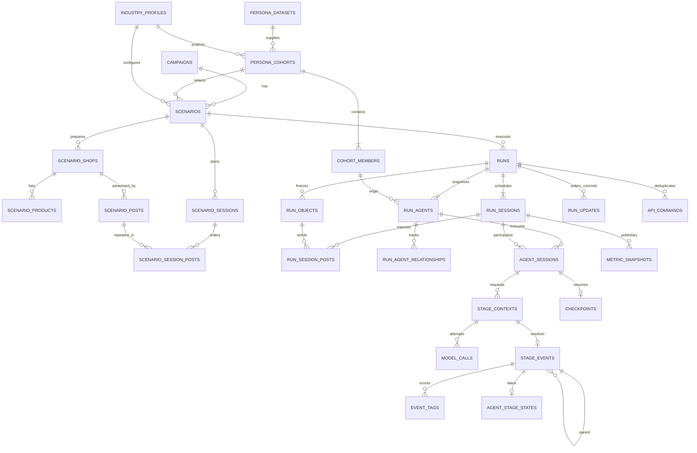

# Dữ liệu và ERD backend v1

## 1. MatrAIx → persona dùng trong run

Giữ Parquet, codebook, manifest gốc trên filesystem quản trị. Không ORM cho
Parquet; ingestion dùng decoder hiện có và `pyarrow`, không đọc shard trong
từng stage. Không đưa 1M persona đầy đủ vào SQLite vận hành.

```text
Đăng ký dataset revision + manifest/schema hash
→ kiểm tra file/hash, giải mã enum/null/override
→ chọn core_fields + domain_fields + grouping_fields của ngành
→ hoàn thiện field thiếu theo policy có seed nếu đã bật
→ kiểm tra enum và provenance
→ nhập reduced persona và cohort vào SQLite
→ scenario chọn cohort + số người + selection_seed
→ khóa danh sách và gán quan hệ brand bằng assignment_seed
→ run sao chụp persona/quan hệ, không cần Parquet để chạy hoặc đọc lịch sử
```

Giữ nguyên giá trị nguồn hợp lệ. Trường không được hoàn thiện vẫn là thiếu,
không tự thay bằng `Neutral`. Mỗi field lưu `observed`, `derived` hoặc
`imputed_prior`, cùng rule/policy/seed/source_fields nếu có. `observed` ở đây
nghĩa là có trong bản ghi nguồn, **không khẳng định đã được người thật xác
nhận**; provenance nguồn human-grounded/synthetic được lưu riêng.

Import là thao tác admin offline, theo lô có transaction và khóa dedup.
Dataset/cohort chỉ công bố `ready` khi đủ số lượng, hash và validator đều qua.
Importer MVP `backend.bootstrap` dùng một transaction: lỗi rollback toàn bộ,
không tạo record `failed` riêng và không để scenario dùng cohort dở dang.
Không nhận đường dẫn Parquet/cohort do HTTP client tùy ý cung cấp.

Chọn N người từ cohort: xếp hạng ổn định
`sha256(selection_seed | cohort_id | cohort_persona_id)` rồi lấy N khác nhau.
N vượt cohort bị từ chối, không nhân bản người. Không dùng `rows[:N]` theo
thứ tự file. Giữ nguyên danh sách khi chạy lại cùng scenario.
MVP không cam kết mẫu N nhỏ giữ tỷ lệ nguồn 60/40 hoặc đại diện dân số.

`relationship_groups` là các tổ hợp biết/quen/thái độ/từng mua, không phải bộ
lọc nguồn persona. Cả danh sách chọn một chế độ `percentage` hoặc `count`;
tổng bằng 100% hoặc N. Làm tròn phần trăm bằng largest remainder, hòa theo thứ
tự nhóm. Response hiển thị cả tỷ lệ yêu cầu, số người thực gán và tỷ lệ thực.
Sau đó xếp persona bằng assignment_seed để phân nhóm, không đổi personality.

## 2. Industry bundle và tag

Bundle bất biến gồm nội dung/hash của:

- schema reduced persona với mô tả tiếng Anh và enum;
- core/domain/grouping fields, mapping tag–persona theo stage;
- registry enterprise/article/product/emotion/thought/attention_reason;
- schema phần `industry_data` của shop/post/product;
- renderer contract, policy normalization/tag selection/relationship;
- completion/selection policy và version.

Registry và bundle giữ JSON versioned. SQLite chỉ lưu metadata/hash bundle,
các trường đã chọn và snapshot nội dung cần cho run; **không cần bảng
`tag_registries` hay bảng `reports` riêng**.
Mỗi consumer nhận bundle được resolve theo scenario, không import global cafe.
Mô tả tag đã dùng cũng lưu trong `event_tags` để đọc lịch sử không phụ thuộc
registry mới. Thêm ngành chỉ khả dụng sau kiểm thử bundle xuyên suốt.

## 3. Campaign, scenario và định danh

Campaign chứa `name`, `brief`, ghi chú nội bộ. Organization/brand, shop,
bài viết, sản phẩm, tag, ngành, cohort, cơ cấu và lịch là **cấu hình scenario**.
Không có `users`, `memberships` hoặc tổ chức đóng vai trò tài khoản.

Scenario `draft` cho phép lưu từng màn hình còn thiếu. `validate` trả lỗi và
preview người tham gia, không gọi model; `freeze` kiểm tra lại rồi khóa thành
`ready`. Sửa sau khi khóa phải tạo scenario mới, có thể điền lại từ dữ liệu
cũ. Campaign brief được snapshot lúc freeze; sửa campaign không thay scenario
đã khóa. Run copy toàn bộ snapshot; một run không đọc cấu hình nháp sống.

`organization_id`, `brand_id`, `shop_id`, `post_id`, `product_id` là khóa
cục bộ trong scenario. Có thể dùng lại cùng ID trong scenario/run khác.
FK và query luôn có scope; tuyệt đối không `INSERT OR REPLACE` đối tượng run.

Giá MVP giữ `listed_price` dạng text công khai như engine đang dùng. Không
suy ra doanh thu từ text này. Shop/product có `industry_data` kiểm tra theo
bundle; không tự đưa toàn bộ object đó vào prompt.

`business.tags` dùng family enterprise sẵn có. `source_ref` hợp lệ là
`organization:{organization_id}:organization_description` hoặc
`brand:{brand_id}:brand_description`; shop tags vẫn dùng
`shop:{shop_id}:public_profile`. Chỉ lấy tag/fact được visibility của stage
cho phép, không truyền toàn bộ business object vào mọi prompt. Nếu enterprise
tag trùng giữa business và shop, dedup theo tag ID, giữ source refs đã kiểm
tra trong audit. Không tự suy ra tag từ tên doanh nghiệp. Adapter context mới
phải bổ sung hai source owner organization/brand vào validator/renderer; runtime
cũ mới hỗ trợ enterprise tag từ shop.

## 4. ERD mục tiêu

Các tên dưới đây là tên bảng mục tiêu, không phải schema hiện tại.



## 5. Data dictionary và khóa

JSON trong bảng là dữ liệu **có schema kiểm tra**, không phải chỗ nhận JSON
tùy ý. Mọi bảng mutable có `created_at/updated_at` UTC; bảng append-only chỉ
cần `created_at`. Hash dùng SHA-256 JSON canonical, từ chối NaN/Infinity.

| Bảng | Khóa và cột nghiệp vụ |
| --- | --- |
| `persona_datasets` | PK `dataset_id`; UNIQUE `(source_name, revision)`; source locator nội bộ, schema/manifest hash, manifest JSON, usage notice, status |
| `industry_profiles` | PK `(industry_id, profile_version)`; bundle locator/hash, metadata JSON, status `ready/disabled` |
| `persona_cohorts` | PK `cohort_id`; FK dataset/profile; content hash, size, selection/completion policies + seeds JSON, status |
| `cohort_members` | PK `(cohort_id, cohort_persona_id)`; UNIQUE `(cohort_id, source_persona_id)`; reduced `persona_json`, provenance, field provenance, source bucket |
| `campaigns` | PK `campaign_id`; name, brief, internal notes, revision |
| `scenarios` | PK `scenario_id`; FK campaign, nullable cohort/profile khi draft; name, revision, status `draft/ready`; `config_json`, `frozen_snapshot_json`, snapshot hash |
| `scenario_shops` | PK `(scenario_id, shop_id)`; name, public_profile, tags JSON, industry_data JSON |
| `scenario_posts` | PK `(scenario_id, post_id)`; FK `(scenario_id, shop_id)`; title, preview, article_content, tags JSON, industry_data JSON |
| `scenario_products` | PK `(scenario_id, product_id)`; FK shop; position, product_name, listed_price, product_description, tags JSON, industry_data JSON |
| `scenario_sessions` | PK `(scenario_id, session_no)`; nullable active_agent_ids JSON |
| `scenario_session_posts` | PK `(scenario_id, session_no, post_id)`; FK session/post; position |
| `runs` | PK `run_id`; FK scenario; scenario revision/hash, immutable `input_snapshot_json`, bundle snapshot JSON, execution/provider metadata JSON; status, started_at, ended_at, failure_code, execution_epoch |
| `run_sessions` | PK `(run_id, session_no)`; status, started_at, ended_at, failure_code |
| `run_agents` | PK `(run_id, agent_id)`; ordinal, source cohort/member FK, source_persona_id; persona/provenance/field_provenance snapshot JSON |
| `run_objects` | PK `(run_id, object_type, object_id)`; type `shop/article/product`; snapshot JSON, nullable parent shop reference, position |
| `run_session_posts` | PK `(run_id, session_no, post_id)`; FK run session/article; position |
| `run_agent_relationships` | PK `(run_id, agent_id, brand_id)`; organization_id, group_id, initial/current state JSON, assignment provenance, last_event_id |
| `agent_sessions` | PK `(run_id, session_no, agent_id)`; active, status `pending/running/completed/failed/inactive`, started_at, ended_at |
| `stage_contexts` | PK `stage_key`; FK agent-session; object type/ID, encounter_no, stage; input snapshot/rendered text, question/schema contract, input_hash, history watermark |
| `model_calls` | PK `call_id`; FK stage_key; UNIQUE `(stage_key, attempt_no)`; source primary/fallback, model/provider, status, validation_status, redacted request/raw response, normalized response, error_code, started_at, ended_at, input/output/total_tokens nullable |
| `stage_events` | PK `event_id`; UNIQUE stage_key FK; FK run/session/agent/object; encounter_no, stage, sequence_no, status, action nullable, score nullable, parent_event_id, source, selected_call_id nullable |
| `event_tags` | PK `(event_id, tag_id)`; score, rank, selected, description snapshot |
| `agent_stage_states` | PK `(run_id, agent_id, object_type, object_id, stage)`; latest_event_id FK; không nhân bản tag vì đọc qua event |
| `checkpoints` | PK `(run_id, session_no, agent_id)`; last_event_id nullable, cursor JSON, execution_epoch |
| `metric_snapshots` | PK `(run_id, session_no, scope_type, scope_id, metric_name, calculation_version)`; numerator/denominator, session_value, cumulative_numerator/denominator/value, projected_through_seq |
| `run_updates` | PK `(run_id, commit_seq)`; kind `stage_committed/run_status/session_completed`; event_id hoặc status/session payload, execution_epoch; không chứa raw prompt |
| `api_commands` | PK `(operation, idempotency_key)`; request_hash, run_id, execution_epoch, response status/body; transaction cùng lệnh create/start/resume |

`config_json` chứa organization/brand, profile/cohort reference, count/seeds,
relationship_groups và policy selection. Shop/post/product/session lưu bảng
con; API ghép chúng thành một ScenarioSetup, không giữ hai bản mutable.
`frozen_snapshot_json` chỉ sinh khi freeze và gồm toàn bộ bảng con, brief,
danh sách persona đã resolve cùng nhóm thực gán, bundle hash.
`input_snapshot_json` sao chụp frozen snapshot, đủ dựng lại các bảng run.

`run_objects` gộp ba loại snapshot để event có FK thật đến đối tượng.
Post/product phải có FK self-reference tới object_type=`shop` cùng run;
`run_session_posts` có cột type cố định `article` để tạo composite FK.
Các cột kỹ thuật type này không yêu cầu frontend nhập.
`run_agent_relationships` current state có thể rebuild từ initial state +
events; không ghi đè persona.

`run_objects` lưu snapshot shop/article/product; business context nằm riêng
trong `runs.input_snapshot_json`, không giả thành tài khoản hoặc shop. Run
readers luôn dùng bản run, không join ngược draft để lấy tên/giá/tag hiện tại.
Agent ID derive từ cohort/member, ổn định qua preview/freeze/run; UNIQUE chỉ
trong run. Một người có thể tham gia nhiều run với quan hệ ban đầu khác nhau.

## 6. Constraints, indexes và transaction

- FK bật trên mọi connection. Quan hệ session/agent/event dùng composite FK
  tới cùng run; event cha phải cùng run/agent/session, stage chuyển tiếp hợp
  lệ. Kiểm tra trong History trước ghi; không dựa mỗi UUID FK.
- UNIQUE vị trí bài `(scenario_id, session_no, position)` và tương tự run.
  UNIQUE vị trí sản phẩm `(scenario_id, shop_id, position)`. Không ép vị trí
  liên tiếp. Session phải là 1..N, có thể rỗng.
- `sequence_no` UNIQUE trong `(run_id, session_no, agent_id)`; khác
  `commit_seq` toàn run. Index history
  `(run_id, agent_id, object_type, object_id, stage, encounter_no)`.
- CHECK điểm hữu hạn thuộc [0,1], status/action hợp lệ. Invalid/unresolved
  có action null. Tag ID/family/version phải thuộc bundle snapshot.
- Index model usage `(run_id, session_no)` được hỗ trợ bằng FK qua
  stage_contexts, **không join qua event bắt buộc**: attempt thất bại cũng
  phải được tính, kể cả chưa có stage event.
- `run_updates` cấp MAX+1 trong transaction single-writer, cùng transaction
  ghi sự thật tương ứng; không dùng SQLite `rowid` ẩn làm public cursor.
- Khởi tạo run nguyên khối: run, agents, objects, lịch, quan hệ,
  agent_sessions/checkpoints ban đầu. Lỗi rollback toàn bộ, không để run
  thiếu lịch được coi là completed. Chi tiết ở [runtime](02-runtime.md).
- Không hard-delete source/cohort/scenario/bundle được run tham chiếu.
  Chưa có delete endpoint. Xóa tài sản trong draft chỉ qua PUT setup và
  validate lại tham chiếu. Lịch sử run không bị ảnh hưởng.

MVP dùng một SQLite file cho nhiều run/scenario; không chữa trùng ID bằng
“mỗi run một database”. Dữ liệu chạy cũ không cần migrate cho đợt backend mới,
nhưng không tự xóa file cũ nếu chưa có lệnh chỉ rõ.
