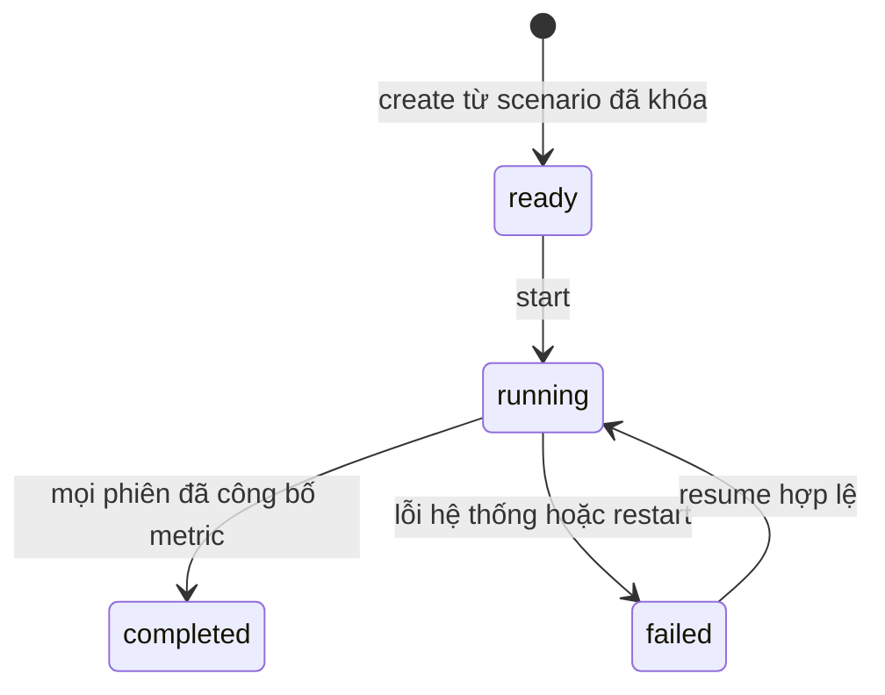

# Runtime, context và độ tin cậy

## 1. Vòng đời



`initializing` là bước **nội bộ transaction create**, không công bố một run
chưa đủ dữ liệu. Tạo thất bại trả lỗi HTTP, rollback và không có run ID hợp
lệ. Không dùng thêm `failed_initialization` persisted. Đây thay thế mô hình
khởi tạo từng phần ở tài liệu cũ.

Start/resume trả 202 sau khi lưu trạng thái và giao việc cho worker; request
HTTP không chờ chạy xong. Trong MVP một worker điều phối tồn tại suốt process,
không buộc run vào vòng đời connection HTTP. Admission lock từ create/start/
resume bảo đảm tối đa một run `running`; run khác trả 409 `RUNNER_BUSY`.
Tạo nhiều run ready được phép. Một process, không chạy nhiều Uvicorn worker.

Create run lưu provider configuration metadata (không key) từ server cùng
execution config. Start kiểm tra lại model/endpoint/policy khớp snapshot và
credentials còn khả dụng; cấu hình model đã đổi thì trả 409 và tạo run mới.
Có thể đổi secret mà không đổi model metadata. Idempotency key scope bao gồm
operation và resource ID, không dùng một key chung cho mọi resource.

Restart: kiểm tra run còn running, đổi thành failed với
`PROCESS_INTERRUPTED`, công bố trạng thái; không tự gọi lại API trả phí.
Resume chủ động xác nhận snapshot/hash/config đủ, tăng execution_epoch,
đổi run và phiên lỗi về running. Giữ nguyên lịch sử đã commit.
Resume completed trả 409; không có pause/cancel trong API v1.

## 2. Trình tự mỗi phiên

1. Lấy đúng lịch của phiên, sắp bài theo position rồi ID. Phiên trống vẫn
   hoàn thành và có metric; không tự phát lại bài cũ vắng mặt trong lịch.
2. Lấy agent active từ frozen snapshot (mặc định tất cả), giữ ordinal.
3. Sequential: lần lượt từng agent. Parallel: chia batch_size agent,
   chờ batch xong trước batch tiếp theo. Stage trong mỗi agent vẫn tuần tự.
4. Agent đi qua mỗi bài một encounter; xử lý nhánh A. A5 visit thì duyệt
   tất cả sản phẩm của shop theo position rồi ID, mỗi sản phẩm một nhánh B.
5. Mark `agent_sessions.completed` khi đã duyệt hết lịch, kể cả không có
   event. Checkpoint stage cuối **không thay thế** cờ hoàn tất agent.
6. Đợi mọi active agent hoàn tất; dựng metric và commit metric + session
   completed + run_update nguyên khối. Không mở phiên sau trước điểm này.
7. Phiên cuối đã công bố metric mới được commit run completed.

```text
A1 chú ý bài
├─ skip → A1R lý do → bài kế
└─ attend/attend_again → A2 cảm nhận → A3 đọc bài → A4 phản ứng
   → A5 cân nhắc ghé shop
     ├─ không ghé → bài kế
     └─ ghé → với mỗi sản phẩm:
              B1 chú ý
              ├─ skip → B1R lý do → sản phẩm kế
              └─ attend/attend_again → B2 suy nghĩ → B3 mua/không mua
```

Empty/unresolved dừng nhánh phụ thuộc, không tạo event giả cho stage chưa
chạy. A4 `no_reaction` hợp lệ vẫn được xét A5. Không thiết kế comment.
Mỗi product encounter gắn parent A5 visit event. `encounter_no` tăng theo
lần tiếp xúc thực tế của agent, không lấy số thứ tự đăng/lượt shop trong
lịch chung. Retry dùng lại encounter đã cấp; checkpoint giữ khóa encounter
để resume không tăng thêm lần giả.

## 3. Context tối thiểu theo stage

| Stage | Input được dùng | Output |
| --- | --- | --- |
| A1 | Flow lướt; persona mapping; tag preview/doanh nghiệp công khai; ký ức bài và lý do skip gần nhất | Phân phối 4 mức chú ý |
| A1R | Snapshot A1 vừa skip, giữ đúng visibility và memory | Điểm attention_reason tags |
| A2 | Flow đã chú ý chưa đọc; persona/tag liên quan; quan hệ brand; ký ức A2 gần nhất | Điểm emotion tags |
| A3 | Nội dung đầy đủ; cảm xúc A2 hiện tại; doanh nghiệp được phép biết; ký ức A3 gần nhất | Điểm emotion tags |
| A4 | Cảm xúc A3; trạng thái phản ứng bài trước đó; ký ức A4 phù hợp | Một action phản ứng hợp lệ |
| A5 | Cảm xúc A3; doanh nghiệp công khai; lịch sử ghé đúng shop; ký ức A5 | Ghé hoặc không ghé |
| B1 | Persona mapping; tên/giá/tag preview sản phẩm, doanh nghiệp; ký ức B1/B2/B3 và lý do skip | Phân phối 4 mức chú ý |
| B1R | Snapshot B1 vừa skip | Điểm attention_reason tags |
| B2 | Persona mapping; tên/giá/mô tả/tag sản phẩm và doanh nghiệp; ký ức B2, thông tin mua trước | Điểm thought tags |
| B3 | Thought B2 hiện tại; tên/giá/mô tả được phép; ký ức B3 và số lần mua đúng sản phẩm | Mua hoặc không mua |

A3 là bước **đọc toàn bộ bài**; A1/A2 không nhận nội dung đầy đủ.
A3/A4/A5/B3 không bổ sung personality mới. A4/B3 không nhét lại toàn bộ tag
doanh nghiệp. Dùng contract hiện hành `context-rendering.v2.json` và mapping,
với version/hash đóng băng, không tự mở rộng mỗi lần render.

Snapshot đầu encounter ghi history watermark; kết quả upstream hiện tại đọc
bằng parent riêng. Ký ức cùng stage là lần gần nhất đúng run/agent/object/stage,
kể cả empty/unresolved; không hồi sinh cảm xúc cũ để bù kết quả trống.
Chỉ lấy selected tags để dựng ký ức; toàn bộ score vẫn lưu audit.

Quan hệ brand khác ký ức bài/sản phẩm: unknown không có hiểu biết cá nhân
sẵn, nhưng vẫn được thấy thông tin công khai thực sự có trên quảng cáo.
Đọc có danh tính brand, ghé shop, mua cập nhật nhận biết/độ quen/từng mua theo
policy. Không tự biến like thành thái độ brand, hay mua thành đã dùng/hài lòng.
“Từng mua brand trước mô phỏng” không chứng minh từng mua sản phẩm cụ thể;
B3 buy_again chỉ dựa lịch sử mua đúng sản phẩm đã biết.

Prompt dùng mô tả tiếng Anh từ schema/tag; không lộ ID kỹ thuật, mục tiêu
campaign nội bộ hoặc suy nghĩ agent khác. Nội dung marketer là dữ liệu,
không được thay system instruction/schema. Raw prompt không trả qua SSE.

## 4. Output và policy

JEV/LLM cùng contract normalized:

- Attention: `probabilities` gồm 4 số hữu hạn, mỗi số [0,1].
- Tag: một distribution 4 số cho mỗi tag trong family được phép, đủ/không
  thừa tag; model không tự đặt tên tag hoặc mô tả tag.
- Action: một lựa chọn trong enum sinh từ history.

Validation thống nhất từ adapter tới policy: sai số tổng xác suất 1e-6.
Không âm, NaN, Infinity; không sửa phân phối hỏng thành hợp lệ. Schema LLM
có description cho trường, mô tả tag/scale và ràng buộc phần tử; kiểm tra
semantic sau structured output vẫn bắt buộc.

Điểm = `Σ(i × p_i)/3`. Các tag chấm độc lập, không ép tổng điểm tag bằng 1.
A1/B1 đạt 0.60 thì attend, trước đó từng chú ý thì attend_again; thấp hơn
là skip hợp lệ, **không gọi fallback vì skip**.
A2/A3/B2 floor 0.30, A1R/B1R floor 0.50, top_k=3, hòa theo tag_id.
Giữ cả score bị loại; description ghép từ registry snapshot. Đây là mặc
định thử nghiệm kế thừa, chưa calibration.

A4: chưa có phản ứng → like/dislike/no_reaction; đã có → keep_current/
remove_reaction/no_new_reaction. MVP giữ contract hiện tại, chưa thêm chuyển
like↔dislike trực tiếp trong một lần. A5: visit/not_visit hoặc
visit_again/not_visit_again. B3: buy/not_buy hoặc buy_again/not_buy_again.
Các hậu tố “lần n” là diễn giải từ lịch sử, không thêm enum cho từng n.

## 5. Lỗi, retry và fallback

Mặc định vận hành mới: deadline 45 giây mỗi HTTP attempt, tối đa 2 transport
attempts/provider cho timeout/kết nối/429/5xx. Retry sau 1 giây; Retry-After
hợp lệ tối đa 5 giây, vượt thì coi provider tạm unavailable để chuyển bước
xử lý lỗi. SDK automatic retry tắt để không nhân số lần chờ. Đây là giới hạn
transport đã được triển khai; cần calibration thêm theo rate limit thực tế,
không hứa latency model. Giới hạn đồng thời toàn process bằng batch_size,
mỗi agent chỉ có một lời gọi in-flight.

| Kết quả primary | Xử lý |
| --- | --- |
| Hợp lệ, dùng được | Resolve, không fallback |
| Tag hợp lệ nhưng tất cả dưới sàn | Một lượt logical LLM fallback |
| Output sai schema/refusal/thiếu tag | Không retry nội dung primary; gọi fallback |
| Lỗi transport tạm thời sau retry | Ghi attempt lỗi; gọi fallback |
| Cấu hình sai/key sai/model không hợp lệ | Dừng run với mã lỗi cấu hình; không lặp hàng loạt |

Fallback dùng cùng context, question definitions, allowed answers và scale;
không trộn hai output. “Một fallback” là một lượt xử lý semantic, có tối đa
hai HTTP attempts vì transport như trên.
Hai tag outputs hợp lệ dưới sàn → empty_result. Các trường hợp còn lại
không có output usable → unresolved, action null. Lỗi SQLite, snapshot/hash
conflict, context vi phạm visibility → fail run, không thay bằng unresolved.
Run có unresolved vẫn có thể completed; report phải công bố số lượng đó.

Mỗi HTTP attempt có record riêng kể cả timeout, usage unknown là null.
Request/raw response được redact; lưu actual provider/model, client elapsed
time, fallback reason. Không gọi elapsed time là thời gian xử lý model.

## 6. Transaction, crash và song song

1. Create: validate scenario ready, kiểm tra dependency; một transaction ghi
   run snapshot và toàn bộ bảng con, api_command rồi ready.
2. Trước gọi model: ghi context + input hash bất biến và attempt started.
   Nhả writer/transaction trước network.
3. Sau nhận response: lưu response/usage/validation riêng trước fallback.
4. Chốt stage: transaction event + toàn bộ tags + latest state + relationship
   + checkpoint + run_update. Rollback toàn bộ khi bất kỳ bước nào lỗi.
5. Agent hoàn tất ghi agent-session completed. Metric cuối phiên và session
   completed cùng transaction; run terminal chỉ sau khi metric đã sẵn sàng.

Stage key = `(run, session, agent, object_type, object_id, encounter, stage)`.
Input hash khác trên cùng khóa → 409/conflict và fail, không ghi đè.
Resume thấy event thì bỏ qua; có response usable đã lưu mà chưa event thì
revalidate/commit không gọi lại; attempt started chưa có response đánh dấu
interrupted và có thể phải gọi lại. Không hứa exactly-once API hay cùng output
LLM khi chạy một run mới.

Một writer SQLite sở hữu connection ghi. Worker chỉ nhận kết quả commit
rồi chạy stage tiếp. Read API dùng connection read-only, transaction ngắn.
Agent không thấy lịch sử của agent khác; trạng thái dùng chung bất biến.
Vì thế parity yêu cầu **cùng model outputs thì cùng hành vi/metric**, không
yêu cầu live LLM trả y hệt giữa hai mode.

Khi một worker lỗi hệ thống: ngừng nhận stage/batch mới; các request đã
in-flight được kết thúc/ghi attempt an toàn, không chạy tiếp nhánh. Drain
workers trước công bố failed; không có event mới sau terminal của epoch đó.
Không công bố metric phiên chưa đủ agent. Resume dựa từng agent-session.
