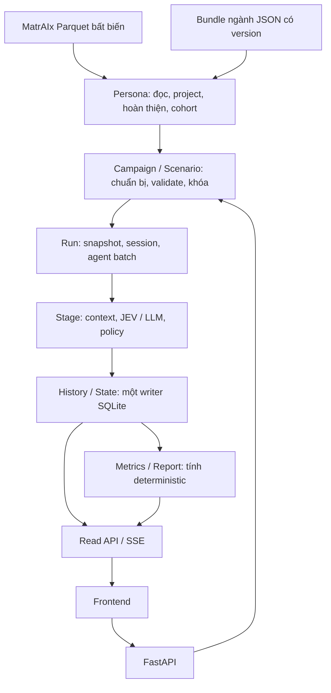

# Thiết kế backend ecoSim v1

Ngày cập nhật: **01/10/2026**. Đây là thiết kế và trạng thái triển khai của
backend mới. Runtime production đã tách khỏi engine cũ và ghi trực tiếp vào
một SQLite backend dùng chung.

## Nguồn thiết kế chính thức

| Tài liệu | Nội dung |
| --- | --- |
| [01-data-and-erd.md](01-data-and-erd.md) | MatrAIx, ngành, scenario, snapshot và ERD/khóa dữ liệu |
| [02-runtime.md](02-runtime.md) | Stage, context, vòng đời run, transaction, lỗi, resume và song song |
| [03-api-and-stream.md](03-api-and-stream.md) | Workflow API, SSE, cursor, báo cáo và metric |
| [openapi.yaml](openapi.yaml) | Contract HTTP máy đọc được, schema request/response |
| [04-delivery-and-checks.md](04-delivery-and-checks.md) | Khoảng cách code hiện tại, vận hành và kiểm thử nghiệm thu |
| [06-bootstrap.md](06-bootstrap.md) | Nạp bundle cafe, metadata MatrAIx và 100 persona vào SQLite |

Bộ này thay thế thiết kế backend ở `docs/technical/services/`,
`session-orchestrator-and-sqlite-erd.md` và `realtime-run-stream-v1.md` khi có
mâu thuẫn. Tag/schema hiện hành vẫn được tham chiếu, không sinh lại tag.
Các quyết định vận hành mới dưới đây là mặc định MVP, không phải kết quả
calibration hay chứng minh độ chính xác hành vi.

## Trạng thái triển khai

- Đã có: dataset/cohort, bundle validation, campaign, scenario draft/freeze,
  run snapshot, quan hệ ban đầu và idempotency.
- Đã có: `backend.bootstrap` nạp dữ liệu nền offline, kiểm tra enum/provenance,
  transaction nguyên khối và chống ghi đè khi chạy lại.
- Đã có: stage contexts, model attempts, stage events, tags, agent state,
  checkpoints, agent-session completion, metrics và history trong backend DB.
- Đã có: sequential/batched-parallel runtime, bounded transport retry,
  rollback/resume cache,
  one-running-run admission, polling và SSE gateway.
- Đã có: mẫu campaign/scenario JSON và API tạo bản nháp nguyên khối,
  chống tạo trùng khi retry, không gọi model.
- Đã kiểm tra offline: 35 HTTP operation theo OpenAPI, metric scope
  run/article/shop/product, history phân trang, terminal/resume/reconnect SSE.
  Chạy `.venv/bin/python -m backend.api.self_check` trong `ecoSim`.
- Chưa kiểm chứng: tải provider thật, SSE slow-client/proxy và token từng
  HTTP retry nội bộ. Không gọi paid API trong các self-check.
- Chưa có: authentication, queue phân tán, pause/cancel và chatbot.

`simulation/legacy/` chỉ giữ mã cũ để tham khảo; production runtime không
import hoặc tạo database execution riêng theo run.

## Phạm vi đã chốt
- Campaign là bản mô tả thông điệp. Một campaign có nhiều scenario; một
  scenario đã khóa có thể chạy nhiều run.
- **Organization và brand là tham số mô phỏng của scenario**: tên, mô tả
  công khai, tag và định danh tham chiếu. Không phải tenant, tài khoản,
  doanh nghiệp sở hữu quyền truy cập hay membership.
- Có nhiều doanh nghiệp được mô phỏng. MVP: một organization/brand trong mỗi
  scenario, nhiều shop/sản phẩm/bài viết của brand đó; không mô phỏng cạnh
  tranh giữa nhiều brand trong cùng run.
- Persona ổn định; quan hệ với brand và ký ức từng đối tượng thay đổi riêng.
  Cơ cấu quan hệ được gán ngẫu nhiên có seed cho các persona đã chọn.
- Cafe là ngành chạy đầu tiên. Cấu trúc dữ liệu không hardcode cafe; chỉ công
  bố một ngành là khả dụng khi bundle và kiểm thử ngành đó đã đủ.
- Lịch cố định quyết định bài được xét trong từng phiên. Bài muốn gặp lại
  phải có mặt trong lịch phiên đó; không tự giữ mọi bài cũ trên “feed”.
- Toàn bộ bài trong lịch được xét chú ý; ghé shop thì xét toàn bộ catalog.
  Không có recommendation, vector search hay lọc top-N.
- JEV qua OpenRouter là primary; LLM fallback trực tiếp OpenAI theo cấu hình
  máy chủ hiện hành. Không yêu cầu người dùng nhập key vào scenario.
- Lưu cả mua/không mua, cảm xúc/suy nghĩ, lý do bỏ qua và lỗi xử lý. Không
  tự đổi lỗi thành hành vi người dùng.
- SSE truyền batch đã commit; frontend có FIFO riêng, không làm chậm engine.

## Kiến trúc tối thiểu

Modular monolith: FastAPI ở lớp HTTP, Pydantic ở biên input/output, Python
engine, SQLite với `sqlite3`. **Chưa thêm ORM**; repository cụ thể và SQL
tham số hóa đủ cho MVP. Không HTTP nội bộ, Redis, Celery hay microservice.

Một process backend, một vòng điều phối run nền, tối đa một run đang tính
tại một thời điểm; trong run có thể chạy nhiều agent song song theo batch.
Run `ready` khác chờ người dùng start, không tự chạy và phát sinh phí.
Ingestion persona chạy offline, không nằm trong request mô phỏng.

| Module | Quyền ghi | Không làm |
| --- | --- | --- |
| Persona | Dataset metadata, reduced persona, cohort, provenance | Gán quan hệ brand hoặc gọi model quyết định |
| Campaign/Scenario | Brief, bản nháp, shop/post/product/lịch; khóa revision | Điều phối stage |
| Run | Snapshot đầu vào, run/session/agent-session, trạng thái thực thi | Tính công thức metric |
| Stage/Context/Gateway/Policy | Yêu cầu History lưu context/attempt/kết quả | Tự mở SQL, đọc Parquet, ghi tùy tiện persona |
| History/State | Event/tag, context, model attempt, state, checkpoint | Quyết định hành động thay model |
| Metrics/Report | Projection metric; đọc lịch sử | Gọi JEV/LLM hoặc sửa event |
| HTTP/Stream | Chuyển request đến module; đọc kết quả đã commit | Gửi mạng trong transaction stage |

Transaction liên module do application service mở qua một unit of work cụ
thể của SQLite; không để từng repository tự commit khi đang materialize run.
Stream không là microservice/publisher riêng.

## Ngoài MVP

Đăng nhập/phân quyền, public hosting nhiều tài khoản, pause/cancel, chatbot,
tự sinh bài từ brief, tự gắn tag bằng LLM, chỉnh persona bằng tay và cơ cấu
nhân khẩu tùy ý chưa triển khai. API chỉ dùng trong môi trường local/nội bộ
tin cậy; nhiều doanh nghiệp mô phỏng **không đồng nghĩa** nhiều tenant.

Marketer tự chuẩn bị bài/sản phẩm và chọn tag từ registry; importer admin
chuẩn bị cohort. Chưa có tồn kho, giỏ hàng, số lượng đặt, ngân sách cá nhân,
đơn hàng, doanh thu hay đơn vị thời gian ngoài đời cho phiên.

Phương án nhẹ hơn là tiếp tục chạy JSON qua CLI và đọc report; bộ thiết kế
này thêm HTTP/setup/SSE để phục vụ sản phẩm đã yêu cầu, không mở rộng engine
sang các nghiệp vụ ngoài phạm vi.
