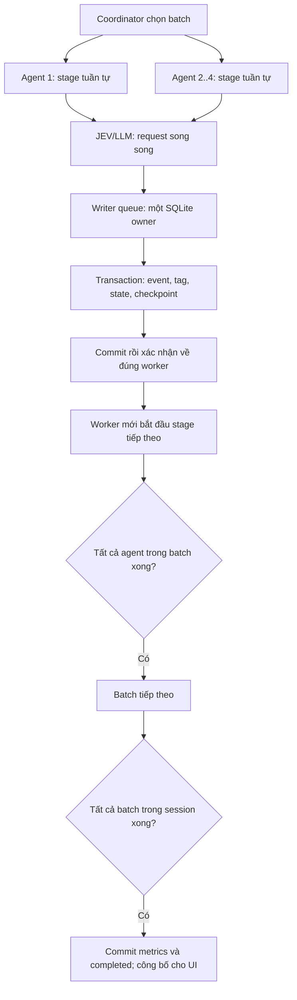

# Hai chế độ chạy và tính nhất quán dữ liệu

## Cách sử dụng

Mặc định vẫn là `sequential`. Mode `parallel` chạy song song **các agent**;
không chạy song song stage của cùng agent, batch hoặc session.

```python
store = SqliteSimulationStore("simulation.sqlite")
stages = StageService(store, primary_gateway, fallback_gateway)
runner = RunCoordinator(
    store, stages, execution_mode="parallel", batch_size=4,
)
runner.run(scenario)
```

Đổi `execution_mode="sequential"` để chạy tuần tự cùng scenario. Mode là tùy
chọn thực thi của coordinator, không sửa nội dung scenario đã khóa.
Parallel yêu cầu SQLite file; chưa hỗ trợ `:memory:` hoặc nhiều process cùng
điều phối một run. Danh sách `active_agents` được áp dụng ở cả hai mode.

## Một writer thực sự, không chỉ một lock chung

`WriterStore` sở hữu một executor với đúng một thread và một SQLite connection.
Mọi lời gọi store của agent đi qua hàng đợi của thread này; cả đọc và ghi đều
trả về kết quả đã hoàn tất. Worker không giữ SQLite connection.



Không giữ transaction lúc chờ HTTP. Request được lưu trước khi gọi model;
response và event/tag/state/checkpoint của stage được commit cùng nhau.
Một lỗi trong transaction phải rollback toàn bộ stage. Thread chính chỉ cập
nhật trạng thái phiên trước khi mở writer; chỉ project metrics sau khi worker
và writer đã đóng. Không có hai writer runtime hoạt động đồng thời.

Mỗi worker dùng `StageService` và gateway độc lập. Gateway hiện tại được clone;
gateway/context service tùy biến có thể dùng `worker_stage_factory(store)`.
Không chia sẻ gateway chứa mutable state giữa agent.

## Vì sao giữ đúng lịch sử

- Chỉ một task phụ trách một agent trong mỗi session.
- Stage sau chỉ đọc lịch sử sau khi stage trước đã nhận xác nhận commit.
- Context chỉ đọc lịch sử của đúng run/agent/object/stage; không dùng phản ứng
  của agent khác. Dữ liệu campaign, bài và catalog giữ nguyên snapshot.
- `sequence_no` vẫn riêng theo run/session/agent; thứ tự ghi giữa các agent
  không phải thứ tự nghiệp vụ và không cần giống mode tuần tự.
- `idempotency_key` giữ nguyên. Resume bỏ qua stage đã commit, không nhân đôi.
- UUID, timestamp, watermark vật lý có thể khác. Khi cấp cùng output model,
  event nghiệp vụ, prompt, tag, parent logic, state và metrics phải giống nhau.
  Hai lần gọi JEV thật không được giả định trả score giống hệt.

Điều kiện này áp dụng khi agent độc lập như flow hiện tại. Nếu bổ sung tồn
kho/ngân sách dùng chung hoặc tương tác giữa agent, phải thiết kế quy tắc phân
xử nghiệp vụ; single writer một mình không bảo đảm parity trong trường hợp đó.

## Checkpoint, lỗi và resume

Checkpoint có `agent_id`, unique `(run_id, session_id, agent_id)`.
Database cũ được chuyển đổi khi mở: giữ bảng cũ thành `checkpoints_legacy_v1`,
dựng checkpoint từng agent từ event cuối đã commit. Không mất event/tag.

Nếu một worker lỗi: chờ các task đã gửi trong batch kết thúc, không mở batch
tiếp theo, không công bố metrics phiên lỗi; run chuyển `failed`. Resume duyệt
lại lịch cố định và dùng idempotency để bỏ qua phần đã commit. Không bảo đảm
exactly-once đối với HTTP nếu response đã về nhưng chưa kịp lưu.

## Kiểm chứng và giới hạn

`python3 -m simulation.parallel_self_check` kiểm tra hai mode với 4 agent,
2 phiên, 88 event/mode, cùng gateway offline chờ 20 ms mỗi call. Kiểm tra cả
tag, prompt, state, parent, metrics, reopen, rollback/resume, checkpoint và
barrier khi batch lỗi. Không phải benchmark khả năng trả lời của JEV.

Probe JEV thật và kết quả: [báo cáo benchmark](../../experiments/jev_parallel_benchmark_report.md).
Chưa có retry/backoff 429 tự động, giới hạn RPM/TPM toàn hệ thống hoặc nhiều
process. Không bật hàng trăm request đồng thời: batch size là giới hạn song
song, không phải tổng số agent. Bản v1 chưa benchmark tải hàng trăm agent.
Đọc qua writer là cách triển khai nhỏ nhất; chỉ thêm read connection riêng
nếu đo thấy hàng đợi SQLite trở thành nút thắt.
