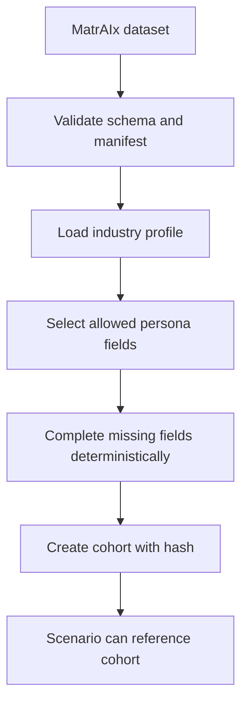

# Persona Service

## Mục đích

Persona Service quản lý đường đi từ dataset MatrAIx đến danh sách người dùng
ảo có thể đưa vào scenario. Service này không mô phỏng hành vi và không gọi
JEV/LLM.

## Trách nhiệm

- Đăng ký dataset MatrAIx, version, manifest, schema hash và điều kiện sử dụng.
- Đọc persona từ Parquet hoặc cohort đã xuất.
- Chọn các field theo `industry_profile`.
- Project persona 1M thành reduced persona dùng cho mô phỏng.
- Hoàn thiện field còn thiếu theo completion policy có seed.
- Lưu provenance cho từng persona và từng field.
- Tạo cohort cố định, có hash và selection policy.
- Kiểm tra cohort có phù hợp ngành và profile version hay không.
- Cung cấp danh sách persona để Scenario Service chọn.

## Không phụ trách

- Không gán `awareness`, `attitude`, `familiarity` với brand.
- Không gán like, dislike, buy hoặc visit.
- Không quyết định context nào được gửi cho model.
- Không sửa persona đã được snapshot vào run.
- Không lưu toàn bộ lịch sử mô phỏng.

## Dữ liệu sở hữu

```text
persona_datasets
- dataset_id
- dataset_version
- source_uri
- schema_hash
- manifest_json
- license_notice

industry_profiles
- industry_id
- profile_version
- core_fields_json
- domain_fields_json
- grouping_fields_json
- tag_registry_version
- persona_mapping_version
- policy_version
- asset_hashes_json

persona_cohorts
- cohort_id
- dataset_id
- industry_id
- profile_version
- selection_seed
- selection_policy_json
- content_hash
- size

cohort_members
- cohort_id
- cohort_persona_id
- source_persona_id
- persona_json
- provenance_json
- field_provenance_json
- cohort_bucket
```

## Đầu vào và đầu ra

### Đầu vào

```json
{
  "industry_id": "cafe",
  "industry_profile_version": "cafe-mvp-v1",
  "cohort_size": 100,
  "selection_seed": 20260928,
  "source_quota": {
    "human_grounded": 60,
    "synthetic": 40
  }
}
```

### Đầu ra

```json
{
  "cohort_id": "cafe-mvp-100-v1",
  "industry_id": "cafe",
  "profile_version": "cafe-mvp-v1",
  "content_hash": "sha256:...",
  "members": [
    {
      "cohort_persona_id": "cafe_mvp_001",
      "source_persona_id": "persona_123",
      "persona": {},
      "provenance": {},
      "field_provenance": {}
    }
  ]
}
```

## Luồng dữ liệu



`cohort_members` là dữ liệu đã project, không phải bản sao toàn bộ schema
1.290 trường của MatrAIx. `field_provenance_json` phải phân biệt tối thiểu:
`observed`, `inferred`, `completed`.
