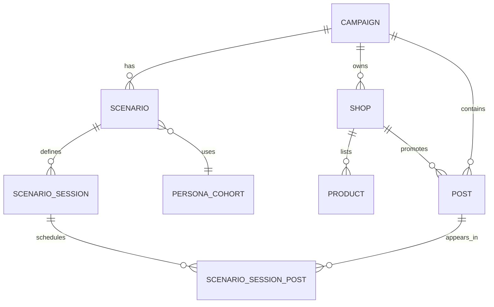

# Campaign & Scenario Service

## Mục đích

Service này quản lý những gì marketer chuẩn bị trước khi mô phỏng. Nó tách
nội dung campaign khỏi một cấu hình chạy cụ thể.

## Phân biệt ba khái niệm

```text
Campaign
  Nội dung marketing chung và tài sản thương hiệu.

Scenario
  Một cấu hình mô phỏng của campaign.

Run
  Một lần thực thi scenario.
```

Ví dụ một campaign có thể có:

```text
Scenario A: 100 agent, 3 phiên, lịch A
Scenario B: 500 agent, 6 phiên, lịch B
Run A-01: chạy Scenario A lần đầu
Run A-02: chạy lại Scenario A với cùng snapshot
```

## Trách nhiệm

- Tạo và quản lý campaign.
- Lưu organization, brand và thông tin công khai.
- Lưu shop, catalog nhiều sản phẩm, giá, mô tả và tag.
- Lưu ngân hàng bài viết, preview, nội dung đầy đủ và tag.
- Tạo scenario từ campaign.
- Chọn `industry_id` và `industry_profile_version`.
- Chọn cohort persona.
- Nhập số agent, số phiên, cơ cấu quan hệ và seed.
- Xếp bài vào session bằng `position`.
- Validate bài trùng vị trí, tham chiếu shop/product và tag visibility.
- Materialize một scenario snapshot để Run Service sử dụng.

## Không phụ trách

- Không gọi model.
- Không chạy stage.
- Không ghi `stage_events`.
- Không sửa scenario sau khi run đã bắt đầu.
- Không tự chọn hành động dựa trên giá hoặc tag.

## Dữ liệu sở hữu

```text
campaigns
- campaign_id
- organization_id
- brand_id
- industry_id
- campaign_name
- internal_goal
- public_brand_profile
- status

scenarios
- scenario_id
- campaign_id
- scenario_name
- industry_id
- industry_profile_version
- cohort_id
- agent_count
- session_count
- policy_version
- relationship_config_json
- execution_config_json
- status

shops
- shop_id
- campaign_id
- public_profile
- tags_json

products
- product_id
- shop_id
- product_name
- listed_price
- product_description
- industry_data_json
- tags_json

posts
- post_id
- campaign_id
- shop_id
- title
- preview
- article_content
- tags_json

scenario_sessions
- scenario_id
- session_no

scenario_session_posts
- scenario_id
- session_no
- post_id
- position
```

## Hỗ trợ nhiều ngành

Phần chung của sản phẩm dùng các trường cố định như tên, giá, mô tả và tag.
Phần riêng ngành nằm trong `industry_data_json`, được kiểm tra bởi profile:

```json
{
  "product_name": "Teddy Bear",
  "listed_price": "299000 VND",
  "industry_data": {
    "age_range": "3-6",
    "material": "cotton",
    "safety_certification": "..."
  }
}
```

Profile sách hoặc cafe không dùng chung validation cho phần domain. Scenario
phải khóa profile version trước khi materialize.

## Quan hệ



`scenario_session_posts` cho phép một bài xuất hiện ở nhiều phiên. `position`
chỉ duy nhất trong một scenario session.
