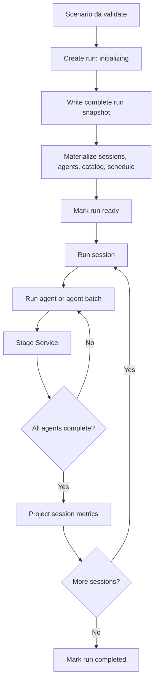

# Simulation Run Service

## Mục đích

Simulation Run Service biến một scenario đã khóa thành một lần mô phỏng và
điều phối các agent qua từng session, bài viết, shop và sản phẩm.

## Trách nhiệm

- Tạo run từ scenario snapshot.
- Chụp industry profile, cohort, campaign asset và policy version.
- Tạo các session của run.
- Materialize agent snapshot và relationship initial state.
- Chạy session theo thứ tự.
- Chạy agent tuần tự hoặc song song theo batch.
- Gọi Stage Service cho từng stage.
- Dừng đúng nhánh khi kết quả `skip`, `not_visit`, `not_buy`,
  `empty_result` hoặc `unresolved`.
- Chỉ chuyển session sang `completed` sau khi tất cả agent thuộc session đã
  hoàn tất.
- Hỗ trợ resume bằng idempotency và checkpoint.
- Chuyển trạng thái run chính xác.
- Phát trạng thái tiến độ sau khi event hoặc session đã commit; không chờ
  frontend nhận dữ liệu.

## Trạng thái run

```text
initializing → ready → running → completed
                          └────→ failed
failed → running           (chỉ khi resume hợp lệ)
```

`ready` nghĩa là snapshot đã được ghi đầy đủ; không được bắt đầu chạy khi
materialization còn dang dở.

## Không phụ trách

- Không đọc trực tiếp Parquet MatrAIx.
- Không tự project persona.
- Không định nghĩa tag hoặc policy.
- Không tự tính metric.
- Không chỉnh lịch hoặc catalog sau khi run bắt đầu.
- Không coi database thiếu lịch là một scenario có lịch trống hợp lệ.

## Dữ liệu sở hữu

```text
simulation_runs
- run_id
- scenario_id
- campaign_id
- industry_id
- profile_snapshot_json
- cohort_snapshot_json
- scenario_snapshot_json
- status
- started_at
- completed_at
- failure_code

run_sessions
- run_session_id
- run_id
- session_no
- status
- started_at
- completed_at

run_agents
- run_id
- agent_id
- cohort_persona_id
- source_persona_id
- ordinal
- persona_snapshot_json
- provenance_snapshot_json

run_agent_relationships
- run_id
- agent_id
- organization_id
- brand_id
- initial_state_json
- group_id
```

## Luồng điều phối



## Transaction boundary

Materialize một run phải là một transaction logic duy nhất. Nếu một phần
snapshot lỗi, run phải ở `initializing` hoặc `failed_initialization`, không
được chuyển thành `ready` hay `completed`.

Trong lúc chạy, không giữ transaction SQLite khi chờ JEV/LLM. Mỗi stage chỉ
commit event, tag, state và checkpoint sau khi nhận kết quả.

Tiến độ frontend dùng stream SSE hoặc polling cùng một cursor. Đây là kênh
quan sát tách khỏi vòng điều phối: lỗi kết nối tới frontend không được làm
thất bại run. Khi run chuyển sang `completed` hoặc `failed`, backend phát một
sự kiện kết thúc độc lập với hàng đợi hoạt cảnh.
