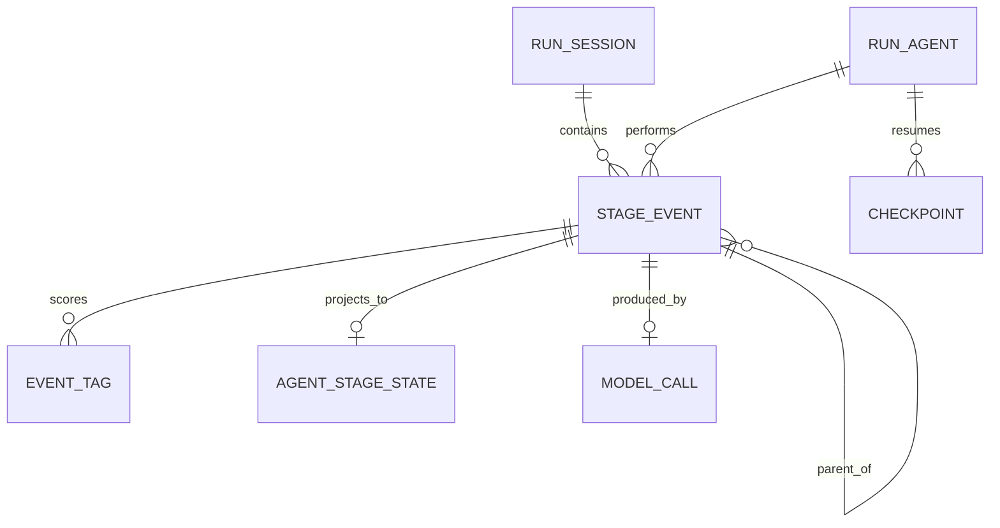

# History & State Service

## Mục đích

History & State Service là nơi lưu sự thật đã xảy ra trong mô phỏng. Nó phục
vụ context của các stage sau, xem lại lịch sử agent, chatbot tương lai và
audit kết quả model.

## Trách nhiệm

- Ghi một stage event sau khi policy đã normalize output.
- Ghi toàn bộ tag và điểm của event.
- Ghi context đã gửi model.
- Ghi trạng thái mới nhất của agent theo object và stage.
- Ghi relationship state sau event hợp lệ.
- Ghi checkpoint theo agent và session.
- Bảo đảm parent event đúng scope.
- Bảo đảm idempotency, rollback và thứ tự event của từng agent.
- Cung cấp lịch sử đã commit cho Context Service và Report Service.

## Không phụ trách

- Không gọi JEV/LLM.
- Không quyết định stage tiếp theo.
- Không chọn cohort.
- Không tự sửa kết quả model.
- Không cộng metric.
- Không tạo action khi model trả `empty_result` hoặc `unresolved`.

## Dữ liệu sở hữu

```text
stage_events
- event_id
- run_id
- session_id
- agent_id
- object_type
- object_id
- encounter_no
- stage
- sequence_no
- status
- action
- normalized_score
- parent_event_id
- idempotency_key
- created_at

event_tags
- event_id
- tag_id
- normalized_score
- rank
- selected
- description

stage_contexts
- stage_key
- run_id
- snapshot_json

agent_stage_states
- run_id
- agent_id
- object_type
- object_id
- stage
- latest_event_id
- last_action
- last_status
- last_score

checkpoints
- run_id
- session_id
- agent_id
- cursor_json
- last_event_id
- status

model_calls
- call_id
- stage_key
- attempt_no
- provider
- model
- request_json
- response_json
- validation_status
- error_code
- status
```

## Quan hệ lịch sử



`stage_events` là append-only về mặt nghiệp vụ. `agent_stage_states` là
projection có thể rebuild từ event, không thay thế event gốc.

## Interface chính

```text
commit_stage(result, context, parent_event) -> event
latest_state(run_id, agent_id, object, stage) -> state
history(run_id, agent_id, object, stage) -> events
checkpoint(run_id, session_id, agent_id) -> cursor
events_after(run_id, cursor) -> committed events
```

`events_after()` là nền tảng cho frontend theo dõi hoặc queue trình bày sau
này. Nó không buộc backend chờ frontend.

### Phát tiến độ

History & State Service chỉ phát tiến độ sau khi dữ liệu đã commit. Run
Progress Stream có thể đọc các event này và gửi `progress_batch`,
`session_completed`, `run_completed` hoặc `run_failed` qua SSE. SSE không phải
là nơi lưu lịch sử; nếu frontend mất kết nối, frontend đọc bù bằng cursor từ
read API.

Thiết kế chi tiết: [realtime-run-stream-v1](../realtime-run-stream-v1.md).
