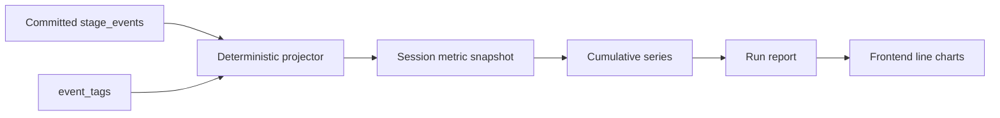

# Metrics & Report Service

## Mục đích

Metrics & Report Service chuyển các event đã commit thành số liệu theo phiên,
số liệu lũy kế và báo cáo cho marketer. Đây là service chỉ đọc lịch sử gốc và
không làm thay đổi hành vi agent.

## Trách nhiệm

- Đọc `stage_events` và `event_tags`.
- Tính metric trong từng session.
- Tính metric lũy kế đến từng session.
- Lưu snapshot metric theo version công thức.
- Giữ tử số và mẫu số cho các tỷ lệ.
- Tách `resolved`, `empty_result`, `unresolved`.
- Phân biệt counter phát sinh và state cuối phiên.
- Tạo báo cáo run.
- Truy vấn lịch sử một agent.
- Về sau tạo metric theo từng bài viết hoặc sản phẩm.

## Không phụ trách

- Không gọi JEV/LLM.
- Không ghi thêm stage event.
- Không sửa action hoặc tag.
- Không dùng giá sản phẩm để tự suy ra doanh thu.
- Không coi `current_likes` là counter lũy kế.

## Phân loại metric

### Counter phát sinh

Có thể hiển thị trong phiên và lũy kế:

```text
posts_exposed
posts_attended
posts_read
likes_added
dislikes_added
shop_visits
products_attended
buys
not_buys
```

### Rate

Phải lưu cả numerator và denominator:

```text
post_attention_rate
read_rate
shop_visit_rate
product_attention_rate
purchase_rate
```

### State cuối phiên

Không cộng dồn:

```text
current_likes
current_dislikes
```

## Dữ liệu sở hữu

```text
metric_snapshots
- run_id
- session_id
- session_no
- scope_type
- scope_id
- metric_name
- numerator
- denominator
- session_value
- cumulative_numerator
- cumulative_denominator
- cumulative_value
- calculation_version

reports
- report_id
- run_id
- calculation_version
- report_json
- generated_at
```

## Luồng tạo báo cáo



Projector phải có thể chạy lại. Cùng một tập event, cùng một
`calculation_version` phải cho cùng một kết quả.

## Interface chính

```text
project_session(run_id, session_id) -> metric snapshots
rebuild(run_id) -> rebuilt snapshots
metric_series(run_id, metric_name) -> ordered points
article_metrics(run_id, post_id) -> object series
product_metrics(run_id, product_id) -> object series
run_report(run_id) -> report
agent_history(run_id, agent_id) -> ordered history
```

Metric theo bài viết/sản phẩm phải ghi rõ scope. Không dùng một metric cấp
run rồi gắn nhãn như thể đó là metric của từng object.
