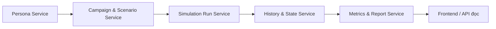
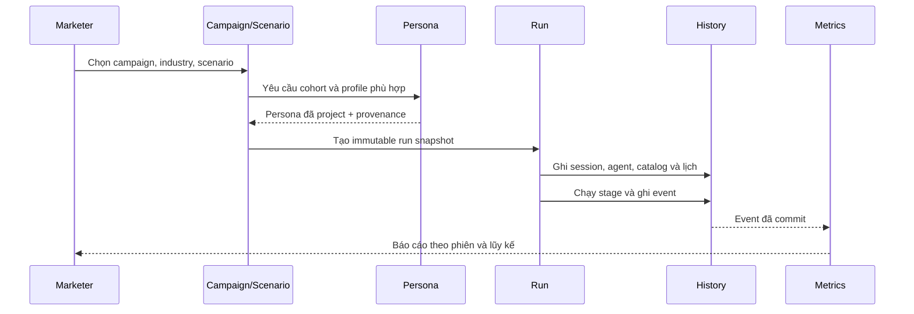

# Thiết kế các service backend

**Ngày:** 29/09/2026  
**Phạm vi:** thiết kế backend cho nhiều campaign, nhiều scenario, nhiều lần
mô phỏng, nhiều ngành và persona lấy từ MatrAIx.

Đây là kiến trúc **modular monolith** cho MVP. Các service là ranh giới
trách nhiệm trong cùng một process và có thể dùng chung một file SQLite.
Chưa tách thành microservice, chưa dùng HTTP nội bộ và chưa chia thành nhiều
database.

## Mục tiêu

- Không để một `Store` hoặc một ERD gánh toàn bộ nghiệp vụ.
- Tách dữ liệu nguồn persona, dữ liệu campaign, dữ liệu cấu hình chạy và
  lịch sử mô phỏng.
- Giữ snapshot bất biến để một run có thể tái hiện đúng.
- Cho phép một campaign có nhiều scenario; một scenario có nhiều run.
- Cho phép mỗi ngành có profile, field, tag, mapping và policy riêng.

## Các service

| Service | Sở hữu chính | Không phụ trách |
| --- | --- | --- |
| Persona Service | MatrAIx, profile ngành, cohort, persona đã project | Quyết định hành động |
| Campaign & Scenario Service | Campaign, brand, shop, sản phẩm, bài viết, lịch, tham số scenario | Chạy JEV/LLM |
| Simulation Run Service | Tạo run, session, điều phối stage, retry/resume | Định nghĩa metric báo cáo |
| History & State Service | Event, tag, context, trạng thái agent, checkpoint | Chọn agent ban đầu |
| Metrics & Report Service | Projection metric và báo cáo chỉ đọc | Ghi thêm hành động agent |
| Run Progress Stream | Phát tiến độ đã commit qua SSE hoặc polling cursor | Không điều phối run, không lưu lịch sử thay thế |

## Quan hệ tổng quát

## Nguyên tắc dữ liệu

1. Dữ liệu nguồn có thể dùng lại; dữ liệu trong run phải là snapshot.
2. Service chỉ ghi vào nhóm bảng mình sở hữu.
3. Service khác chỉ đọc qua interface, không truy cập trực tiếp bảng nội bộ
   trong code nghiệp vụ.
4. `stage_events` là lịch sử gốc; metric chỉ là dữ liệu dẫn xuất.
5. Không lưu toàn bộ MatrAIx 1M persona vào database vận hành. Chỉ lưu
   metadata dataset, cohort đã chọn và các persona được dùng.
6. Một run đã bắt đầu không được đổi industry profile, persona, catalog,
   bài viết hoặc lịch đăng.

## Tài liệu thành phần

- [Persona Service](01-persona-service.md)
- [Campaign & Scenario Service](02-campaign-scenario-service.md)
- [Simulation Run Service](03-simulation-run-service.md)
- [History & State Service](04-history-state-service.md)
- [Metrics & Report Service](05-metrics-report-service.md)
- [Luồng tiến độ mô phỏng qua SSE](../realtime-run-stream-v1.md)

## Trình tự materialize một run

