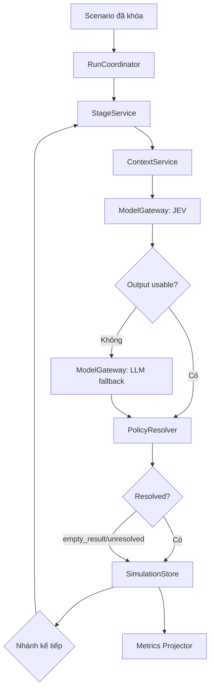
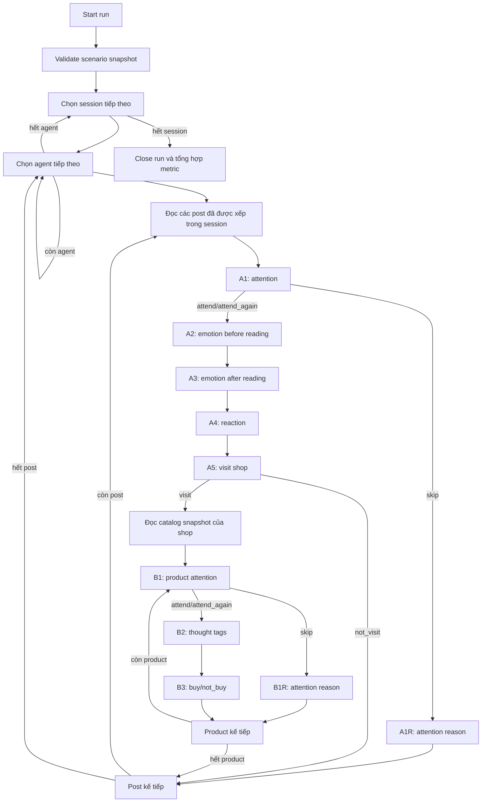
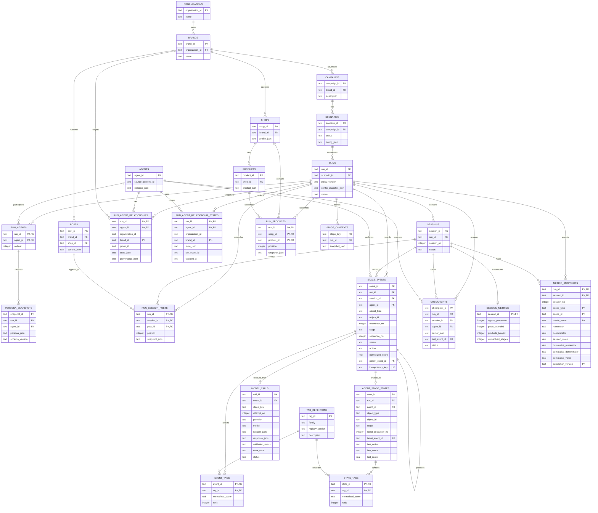

# Thiết kế bộ điều phối và SQLite Store

**Trạng thái:** v1 runtime skeleton đã triển khai; `ContextService` đã tích hợp
và kiểm tra offline; OpenRouter chưa được gọi trong self-check  
**Phạm vi:** mô phỏng nhiều session, agent chạy tuần tự hoặc song song theo batch,
lưu lịch sử suy nghĩ/cảm xúc/hành động
của từng agent. Tài liệu mô tả kiến trúc; phần runtime tối thiểu nằm trong
thư mục `simulation/`.

Nguồn policy hiện hành là [FRD-05](../frd/05-session-policy-and-state.md).
Hai mode và ranh giới ghi dữ liệu:
[parallel-execution-v1](parallel-execution-v1.md).

## 1. Phân biệt bộ điều phối và bộ lưu trữ

### Session orchestrator

Bộ điều phối chỉ giữ thứ tự chạy và quyết định stage kế tiếp dựa trên kết quả
đã được chuẩn hóa. Nó không tự chấm điểm, không tự sinh tag, không mở
transaction và không chứa câu SQL.

Các thành phần phối hợp nhưng không cùng một trách nhiệm:

- `ScenarioLoader`: đọc, validate và canonicalize input marketer thành
  scenario snapshot.
- `ScenarioValidator`: kiểm tra schema, tham chiếu campaign/shop/product,
  lịch đăng, tag visibility và persona enum trước khi ghi run.
- `RunCoordinator`: tạo run, duyệt session/agent và giữ thứ tự xử lý.
- `StageService`: gọi context service, gọi model, áp dụng policy và trả
  `StageResult`.
- `ContextService`: đọc snapshot bất biến, chọn persona fields theo mapping,
  kiểm tra tag/fact được phép thấy, dựng history đúng scope và render context
  độc lập cho đúng stage.
- `ModelGateway`: gọi JEV hoặc LLM fallback; không quyết định nhánh nghiệp vụ.
- `PolicyResolver`: validate, normalize, chọn tag/action và xác định nhánh tiếp.
- `SimulationStore`: giao diện đọc/ghi history, state và checkpoint.
- `SqliteSimulationStore`: triển khai `SimulationStore` bằng SQLite.
- `WriterStore`: một thread sở hữu SQLite trong mode parallel; agent chờ
  kết quả đã commit trước khi chạy stage tiếp theo.
- `MetricsProjector`: cập nhật metric từ event đã commit.

Ranh giới trách nhiệm:

```text
Orchestrator
  điều khiển thứ tự và nhánh
        ↓
StageService
  ghép context → gọi model → resolve kết quả
        ↓
SimulationStore
  đọc history / commit event, state, checkpoint
```

`StageService` có thể yêu cầu store commit kết quả, nhưng không biết SQLite
schema hoặc tự quản lý cursor của toàn run. `SimulationStore` không quyết định
stage kế tiếp. Đây là các dependency độc lập, không phải một bộ điều phối
gánh toàn bộ trách nhiệm.

Đây là ranh giới module, không phải yêu cầu tách thành microservice. Bản v1
có thể chạy trong một process với cấu trúc tối thiểu:

```text
  orchestrator.py       # RunCoordinator và vòng lặp session
  scenario_loader.py    # Load và chuẩn hóa scenario
  scenario_validator.py # Validation deterministic trước khi tạo run
  stage_service.py      # StageService
  context_service.py    # ContextService và context snapshot
model_gateway.py      # JEV và LLM fallback
policy.py             # PolicyResolver
store_sqlite.py       # SqliteSimulationStore
```

Các module dùng interface đơn giản để dễ kiểm thử; chỉ `store_sqlite.py` biết
câu SQL và transaction.



### ContextService và context snapshot

`ContextService` là lớp xây dựng đầu vào cho một lời gọi JEV/LLM. Nó không gọi
model và không quyết định action. Mỗi context được định danh bởi:

```text
run + session + agent + object + encounter + stage
```

Trước khi render, service:

- đọc persona, doanh nghiệp, bài viết/sản phẩm và lịch cố định từ run snapshot;
- chỉ chọn persona field được mapping cho stage và tag đang hiển thị;
- xác nhận `source_ref` của tag thuộc đúng object, field công khai và stage;
- không đưa full article vào A1/A2, không đưa product description vào B1;
- tách `current upstream state` của lượt hiện tại khỏi
  `previous same-stage state` của lần gặp trước;
- giới hạn history theo đúng agent/object và watermark trước khi stage bắt đầu;
- lưu rendered context vào `stage_contexts` để retry không tạo prompt khác cho
  cùng stage key.

Context cuối cùng là prompt độc lập bằng tiếng Anh: model không cần biết
database ID, registry nội bộ hay module nào đã tạo ra dữ liệu. ID và snapshot
được giữ ở lớp audit/storage, không dùng như nội dung suy diễn của model.

`A1R`/`B1R` tái sử dụng context chú ý hiện tại và chỉ hỏi lý do của một `skip`
đã commit; chúng không được thay đổi action. `A5` vẫn giữ article scope để dùng
cảm xúc A3 hiện tại, còn số lượt ghé shop được tính riêng từ các bài của cùng
shop. Khi vào `B1`, event ghé shop `A5` được truyền làm parent để scope của
lần duyệt catalog không bị mất.

## 2. Thứ tự điều phối một run

Run dùng snapshot bất biến của scenario. Sau khi bắt đầu, lịch không được sửa.
Thứ tự mặc định là `run → session → agent → post → stage → product → stage`.
Các danh sách được sắp xếp bằng khóa ổn định để chạy lại cho cùng input cho ra
thứ tự event có thể kiểm tra được.



`empty_result` hoặc `unresolved` chỉ dừng nhánh phụ thuộc. Không biến lỗi model
thành `no_reaction`, `not_buy` hoặc một action khác. Lỗi ghi SQLite dừng run vì
tiếp tục sẽ làm history không đáng tin cậy.

## 3. Ranh giới transaction và resume

Một stage dùng hai pha lưu trữ ngắn, vì không nên giữ transaction SQLite trong
suốt thời gian chờ API bên ngoài:

1. **Trước khi gọi model:** tạo một `model_call` attempt với request snapshot,
   input hash và trạng thái `started`, rồi commit.
2. **Sau khi nhận output:** trong một transaction ngắn, cập nhật raw response
   và trạng thái validate; nếu có kết quả resolve được thì tạo `stage_event`,
   các tag, state projection, counter và checkpoint; nếu là `empty_result` hoặc
   `unresolved` thì tạo processing record tương ứng và checkpoint nhưng không
   tạo action giả.
3. Commit toàn bộ dữ liệu của pha hai cùng nhau.

Request được lưu trước khi gọi model để audit. Raw response được lưu riêng và
không chứa API key. Crash sau khi gọi API nhưng trước commit có thể phải gọi
lại; hệ thống chỉ bảo đảm không tạo duplicate event đã commit, không tuyên bố
exactly-once đối với API bên ngoài. `model_call` có thể tồn tại mà chưa có
`stage_event`; đó là attempt đang dở hoặc không tạo ra kết quả nghiệp vụ.

Idempotency key của stage:

```text
run_id + session_id + agent_id + object_type + object_id + encounter_no + stage
```

Retry giữ nguyên khóa nghiệp vụ nhưng có `attempt_no` riêng trong
`model_calls`. Nếu cùng khóa có input hash khác, đánh dấu conflict và dừng run.
Checkpoint lưu cursor hiện tại; resume bắt đầu từ stage chưa commit, không chạy
lại các stage đã commit.

## 4. ERD logic cho SQLite



## 5. Ý nghĩa các nhóm dữ liệu

- `RUNS`, `SESSIONS`, `RUN_SESSION_POSTS`, `RUN_PRODUCTS`: input bất biến của
  một lần chạy; không dùng lại trực tiếp cấu hình đang chỉnh sửa.
- `STAGE_EVENTS`: nhật ký nghiệp vụ append-only. Đây là nguồn giải thích agent
  đã chú ý, bỏ qua, nêu tag, phản ứng, ghé shop, mua hoặc không mua như thế nào.
- `STAGE_CONTEXTS`: snapshot của context đã render cho một stage key. Đây là
  cache/audit của đầu vào model, không phải memory mới của agent và không được
  dùng để thay thế `STAGE_EVENTS`.
- `EVENT_TAGS`: các tag thought, emotion và attention-reason cùng score sau
  normalize; không lưu định nghĩa tag do model tự sinh.
- `AGENT_STAGE_STATES`: projection mới nhất để lấy nhanh “lần gần nhất khi ở
  đúng bước xử lý này”. Nó không thay thế event history.
- `MODEL_CALLS`: audit input/output từng attempt, kể cả attempt invalid hoặc
  dưới floor.
- `CHECKPOINTS`: vị trí tiếp tục chạy, không phải memory của agent.
- `SESSION_METRICS`: summary tương thích cho một số counter cơ bản; có thể
  xóa và dựng lại từ event.
- `METRIC_SNAPSHOTS`: projection chính thức theo từng session, gồm giá trị
  session và cumulative để dashboard polling/state chart. Đây là dữ liệu dẫn
  xuất và không thay thế `STAGE_EVENTS`.

`AGENT_STAGE_STATES` là nơi phục vụ context history nhanh; khi dựng prompt,
`ContextService` chỉ lấy state đúng `run + agent + object + stage`, sau đó bổ
sung các liên kết liên bước đã được policy cho phép, chẳng hạn thought B2 ngay
trước quyết định B3. Không lấy “emotion mới nhất của agent ở bất kỳ nơi nào”
để làm ký ức của stage hiện tại.

## 6. Khóa và trạng thái bảng

Các ràng buộc quan trọng cần được triển khai bằng SQLite:

- `runs`: `run_id` duy nhất; chỉ cho phép một snapshot scenario bất biến.
- `sessions`: unique `(run_id, session_no)`.
- `run_agents`: unique `(run_id, agent_id)` và unique `(run_id, ordinal)`.
- `run_agent_relationships`: unique `(run_id, agent_id, organization_id,
  brand_id)`; state khởi tạo không được trộn vào `persona_json`.
- `run_agent_relationship_states`: giữ projection hiện tại riêng với initial
  assignment; `last_event_id` giúp audit transition.
- `run_session_posts`: unique `(run_id, session_id, post_id)` và unique
  `(run_id, session_id, position)`.
- `run_products`: unique `(run_id, shop_id, product_id)`.
- `stage_events`: unique `idempotency_key`.
- `checkpoints`: unique `(run_id, session_id, agent_id)`; không dùng cursor
  session chung cho nhiều agent.
- `model_calls`: unique `(stage_key, attempt_no)`; `event_id` nullable cho tới
  khi attempt được resolve thành stage event.
- `agent_stage_states`: unique `(run_id, agent_id, object_type, object_id,
  stage)`.
- `stage_contexts`: unique `stage_key`; cùng stage key chỉ được lưu một context
  bất biến.
- `event_tags` và `state_tags`: unique `(event_id, tag_id)` và
  `(state_id, tag_id)`.
- `metric_snapshots`: unique `(run_id, session_id, scope_type, scope_id,
  metric_name, calculation_version)`.

`stage_key` là chuỗi ổn định được tạo từ cùng các thành phần của idempotency
key. `attempt_no` chỉ phân biệt các lần gọi model cho cùng một stage; nó không
được dùng để tạo thêm event nghiệp vụ.

Trạng thái tối thiểu:

```text
run/session:      pending → running → completed | failed | paused
model_call:       started → responded → validated | invalid | failed
stage_event:      resolved | empty_result | unresolved
checkpoint:       active → committed | invalidated
```

`model_call.status=responded` chưa có nghĩa stage thành công. Chỉ
`validation_status=usable` và policy resolver tạo được kết quả hợp lệ mới có
thể sinh action hoặc selected tags.

## 7. Nguyên tắc triển khai sau này

- Dùng một writer tuần tự cho SQLite. Mode parallel chạy agent worker song
  song, còn store calls đi qua `WriterStore`; mỗi agent chờ commit stage.
- Bật foreign key và WAL khi khởi tạo database.
- Không lưu API key, raw persona dataset hoặc dữ liệu campaign nhạy cảm vào
  repository.
- Giữ raw model output để audit nhưng dùng normalized event/state cho mô phỏng.
- Chỉ thêm bảng khi có truy vấn hoặc transaction cụ thể cần nó; không biến
  SQLite thành một message broker.

## 8. Runtime skeleton hiện tại

Đã triển khai các module tối thiểu trong thư mục `simulation/`:

- `policy.py`: chuẩn hóa score, chọn tag và kiểm tra action theo history.
- `store_sqlite.py`: schema SQLite, event history, latest state, model call,
  checkpoint và idempotency.
- `metrics_projector.py`: dựng snapshot metric từ `stage_events`.
- `report_service.py`: đọc report, metric series và lịch sử agent cho UI/chatbot.
- `stage_service.py`: gọi gateway, fallback, resolve và commit một stage.
- `model_gateway.py`: JEV Decisions API, structured-output LLM và router pool.
- `orchestrator.py`: hai mode agent; batch/session có barrier, stage trong
  mỗi agent vẫn tuần tự.
- `writer_store.py`: single-writer queue, không chia sẻ connection ra worker.
- `parallel_self_check.py`: benchmark 4 agent, parity và rollback/resume.
- `self_check.py`: fixture gateway offline để kiểm tra toàn bộ chuỗi.

`ContextService` đã dựng context từ persona trong scenario, tag registry,
mapping và history theo stage. `StageService` gọi service này trước gateway.
Adapter JEV và LLM qua 9Router đã có; self-check không gọi API trả phí.
Loader kiểm tra industry profile và lưu snapshot/hash tài nguyên; xem
[industry-profile-v1](industry-profile-v1.md).

Chạy kiểm tra:

```bash
python3 -m simulation.self_check
```

Còn thiếu policy đưa quan hệ vào context và các quy tắc chuyển trạng thái sau
bằng chứng. Quan hệ khởi tạo đã được materialize trước run; không coi persona
tổng hợp trong fixture là cohort thật.
